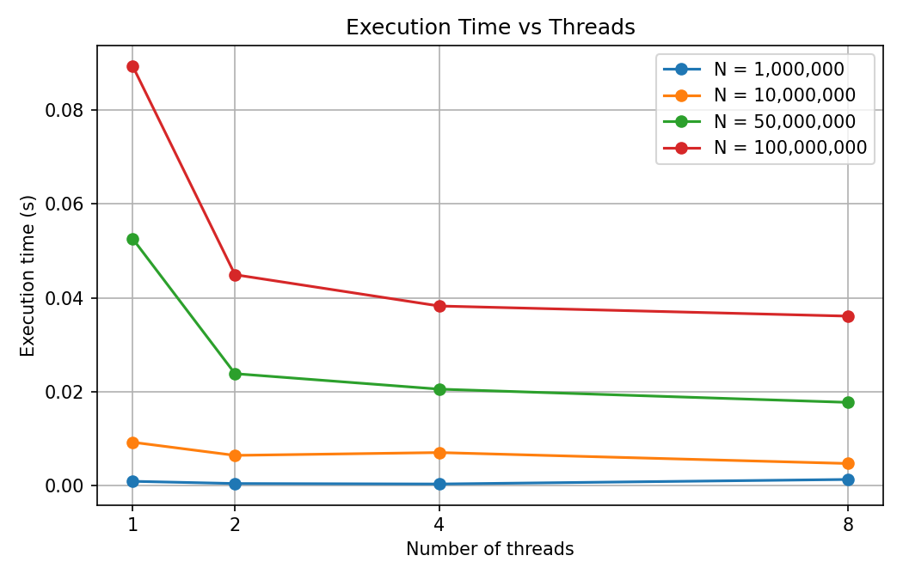
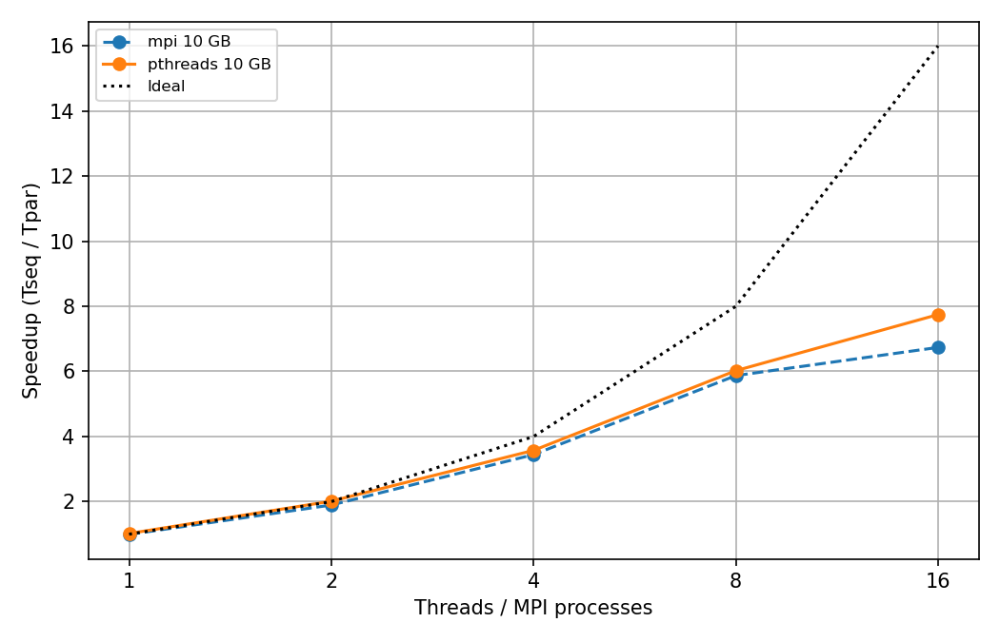
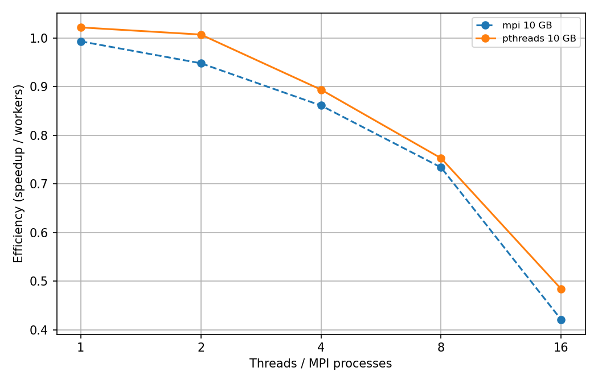

# Parallel Sum and Average of a Dataset using OpenMP

**Team 3, Parallel Computing Mini-Project**
**Team Members:**
1. Akshatha M (01FE24BCI080)
2. Kavya M (01FE24BCI056)

## Objective
Compute the sum and average of a large array using multiple OpenMP threads and analyse execution time, speedup and efficiency against a sequential version.

## Approach
- **Sequential:** one loop adds all N elements; average = sum / N.
- **Parallel:** `#pragma omp parallel for reduction(+:s)`. The array is split among threads, each thread adds its chunk into a private partial sum, and OpenMP combines them at the end. This avoids a race condition.
- **Speedup** = T_sequential / T_parallel. **Efficiency** = Speedup / threads.

## Folder structure
- `src/` : sum_avg.c (sequential + parallel code)
- `data/` : note on dataset (generated in code)
- `results/` : results.csv (raw timings)
- `graphs/` : execution_time.png, speedup.png, efficiency.png
- `report/` : optional PDF report
- `run_experiments.sh` : builds and runs all experiments
- `plot.py` : makes the graphs

## How to build and run
```bash
gcc -O2 -fopenmp src/sum_avg.c -o sum_avg -lm
./sum_avg 10000000 4 3        : N, threads, repeats
./run_experiments.sh         
python3 plot.py               
```

## Experimental setup
WSL Ubuntu on Windows, GCC with `-O2 -fopenmp`, 18 logical cores (`nproc`). CPU: Intel Core Ultra 5 125H.
Each point is the average of 5 runs after one warm-up run.

## Results
| N | Threads | Seq (s) | Par (s) | Speedup | Efficiency |
|---|---|---|---|---|---|
| 1,000,000 | 1 | 0.001093 | 0.000927 | 1.179 | 1.179 |
| 1,000,000 | 2 | 0.000934 | 0.000453 | 2.061 | 1.030 |
| 1,000,000 | 4 | 0.001090 | 0.000353 | 3.090 | 0.773 |
| 1,000,000 | 8 | 0.002010 | 0.001322 | 1.520 | 0.190 |
| 10,000,000 | 1 | 0.008657 | 0.009242 | 0.937 | 0.937 |
| 10,000,000 | 2 | 0.009482 | 0.006450 | 1.470 | 0.735 |
| 10,000,000 | 4 | 0.011544 | 0.007052 | 1.637 | 0.409 |
| 10,000,000 | 8 | 0.011956 | 0.004721 | 2.533 | 0.317 |
| 50,000,000 | 1 | 0.053091 | 0.052539 | 1.011 | 1.011 |
| 50,000,000 | 2 | 0.041928 | 0.023854 | 1.758 | 0.879 |
| 50,000,000 | 4 | 0.043826 | 0.020556 | 2.132 | 0.533 |
| 50,000,000 | 8 | 0.045088 | 0.017739 | 2.542 | 0.318 |
| 100,000,000 | 1 | 0.087540 | 0.089289 | 0.980 | 0.980 |
| 100,000,000 | 2 | 0.082629 | 0.044929 | 1.839 | 0.920 |
| 100,000,000 | 4 | 0.088248 | 0.038264 | 2.306 | 0.577 |
| 100,000,000 | 8 | 0.090780 | 0.036108 | 2.514 | 0.314 |

The sequential and parallel averages matched in every run (relative error about 1e-13 or smaller).

### Graphs




## Analysis
- Execution time falls as threads increase, but speedup levels off at about 2.5x for large N, well below the ideal line. Summing is a memory-bound operation, so memory bandwidth limits scaling more than the number of cores.
- Efficiency drops as threads increase (about 0.9 at 2 threads, about 0.3 at 8) because overhead and memory limits grow while the work per thread shrinks.
- For small N (1M), 8 threads is slower than 4 because thread creation and scheduling overhead outweighs the tiny amount of work.
- Tiny differences between sequential and parallel sums (about 1e-13) come from floating-point addition being non-associative: threads add in a different order.

## Conclusion
OpenMP `reduction` gives a correct and simple parallel sum with a measurable speedup, best for large datasets. Gains are limited by memory bandwidth and overhead.
